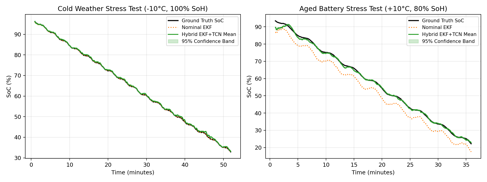

# EV Battery State-of-Charge (SoC) Estimation: Hybrid Physics-AI (EKF + Residual TCN) & ONNX Edge Deployment

An end-to-end Battery Management System (BMS) benchmark comparing classical physics-based estimation (**Extended Kalman Filter**), tabular ML, pure deep learning (**PyTorch LSTM** & **1D-CNN**), and a **Hybrid Physics-Informed Residual Dilated TCN** across temperatures (**-10°C to +25°C**) and battery aging (**80% SoH**), with **Monte Carlo Dropout** uncertainty quantification and **ONNX Runtime** CPU latency profiling.

---

## Engineering Motivation

Under dynamic acceleration and regenerative braking, Li-ion terminal voltage ($V_{\text{term}}$) diverges from Open-Circuit Voltage ($\text{OCV}$) due to temperature- and SoC-dependent ohmic resistance ($R_0$) and RC polarization ($V_{RC}$):

$$V_{\text{term}}(t) = \text{OCV}(\text{SoC}(t)) - I(t) \cdot R_0(T, \text{SoC}) - V_{RC}(t)$$

A nominal **Extended Kalman Filter (EKF)** achieves near-zero error on a brand-new cell (`0.032% MAE`), but real-world EV packs experience capacity fade and impedance growth. Under an unseen **80% State-of-Health (SoH)** stress test (+35% internal resistance, -20% capacity, and current sensor bias), nominal EKF error degrades to `4.868% MAE`.

To combine the physical stability of EKF with the adaptability of deep learning, this project implements a **Hybrid Residual Physics-AI architecture**:

$$\widehat{\text{SoC}}_{\text{hybrid}}(t) = \text{SoC}_{\text{EKF}}(t) + f_{\theta}\big(V, I, T, R_{\text{est}}, \text{SoC}_{\text{EKF}}, V_{\text{innovation}}\big)$$

Instead of predicting SoC from scratch, a Dilated 1D-CNN (TCN) takes strictly causal online impedance estimates ($R_{\text{est}} = -\Delta V / \Delta I$ during load transients) and EKF voltage innovations ($V_{\text{meas}} - V_{\text{pred}}$) to correct physics mismatch in real time.

---

## Architecture & Pipeline

- `src/generate_battery_data.py` — 1st-order Thevenin Equivalent Circuit Model (ECM) simulating 16 dynamic drive cycles (44,193 telemetry rows) from `-10°C` to `25°C`, trained on `85%–100% SoH` cells and evaluated on unseen healthy cycles plus an extrapolated `80% SoH` degraded cell.
- `src/ekf.py` — Strictly causal Extended Kalman Filter outputting nominal SoC estimates and voltage innovation signals.
- `src/models.py` — Three PyTorch sequential architectures:
  - **SoCLSTM:** 2-layer LSTM baseline.
  - **SoC1DCNN:** Lightweight Temporal 1D-CNN for embedded inference.
  - **HybridResidualTCN:** Dilated 1D-CNN (`dilations = 1, 2, 4, 8`, `60s` window covering low-temperature RC relaxation $\tau = R_1 C_1$) with **Monte Carlo Dropout** for 95% confidence bands.
- `src/train_and_evaluate.py` — Causal online impedance ($R_{\text{est}}$) and rolling window feature engineering (`15s`, `60s`, `180s`), GPU training (Huber Loss + Cosine Annealing), 6-model evaluation, ONNX export, and CPU latency benchmarking.

---

## Benchmark Results (Unseen Test Cycles)

| Model | All Cycles MAE (%) | Healthy 100% SoH MAE (%) | Aged 80% SoH MAE (%) | RMSE (%) | $R^2$ |
| :--- | :---: | :---: | :---: | :---: | :---: |
| **Extended Kalman Filter (Physics)** | 0.970 | **0.032** | 4.868 | 2.176 | 0.99064 |
| **Ridge Regression (Linear)** | 1.992 | 2.124 | 1.444 | 2.332 | 0.98925 |
| **HistGradientBoosting (Tabular)** | 2.066 | 2.036 | 2.190 | 2.568 | 0.98696 |
| **PyTorch LSTM (Sequential DL)** | 1.333 | 1.347 | 1.272 | 1.607 | 0.99490 |
| **PyTorch 1D-CNN (Edge DL)** | 0.894 | 0.929 | 0.749 | 1.116 | 0.99754 |
| **Hybrid EKF + Residual TCN (Physics-AI)** | **0.280** | 0.214 | **0.550** | **0.462** | **0.99958** |

### Key Takeaways
1. **Aging Extrapolation:** On the unseen `80% SoH` stress test, **Hybrid EKF + Residual TCN** reduces MAE by **88.7%** compared to nominal EKF (`4.868%` → `0.550%`) while preserving sub-0.25% accuracy on healthy packs (`0.214%`).
2. **Real-Time Edge Performance (ONNX Runtime CPU, Batch Size = 1, SeqLen = 60):**

| Exported ONNX Model | Latency (ms/sample) | Throughput (Hz) | Model Size (KB) |
| :--- | :---: | :---: | :---: |
| `models/soc_lstm.onnx` | 0.212 ms | 4,727 Hz | 222.9 KB |
| `models/soc_1dcnn.onnx` | **0.088 ms** | **11,330 Hz** | **111.3 KB** |
| `models/soc_hybrid_tcn.onnx` | 0.105 ms | 9,518 Hz | 132.7 KB |

The hybrid residual TCN runs **2× faster than LSTM** at **~9.5 kHz** on a single CPU thread (exceeding typical 10–100 Hz BMS sampling rates by two orders of magnitude).

---

## Visual Results

### 1. SoC Tracking Across Temperatures (-10°C to 25°C) & 80% SoH Aging


### 2. Model Robustness: Healthy (100% SoH) vs. Aged (80% SoH) Cell


### 3. Safety-Aware Uncertainty Quantification (MC Dropout 95% Confidence Band)


---

## Quickstart

```bash
git clone [https://github.com/printulfericit1/ev-battery-soc-estimation.git](https://github.com/printulfericit1/ev-battery-soc-estimation.git)
cd ev-battery-soc-estimation
pip install -r requirements.txt

python src/generate_battery_data.py
python src/train_and_evaluate.py