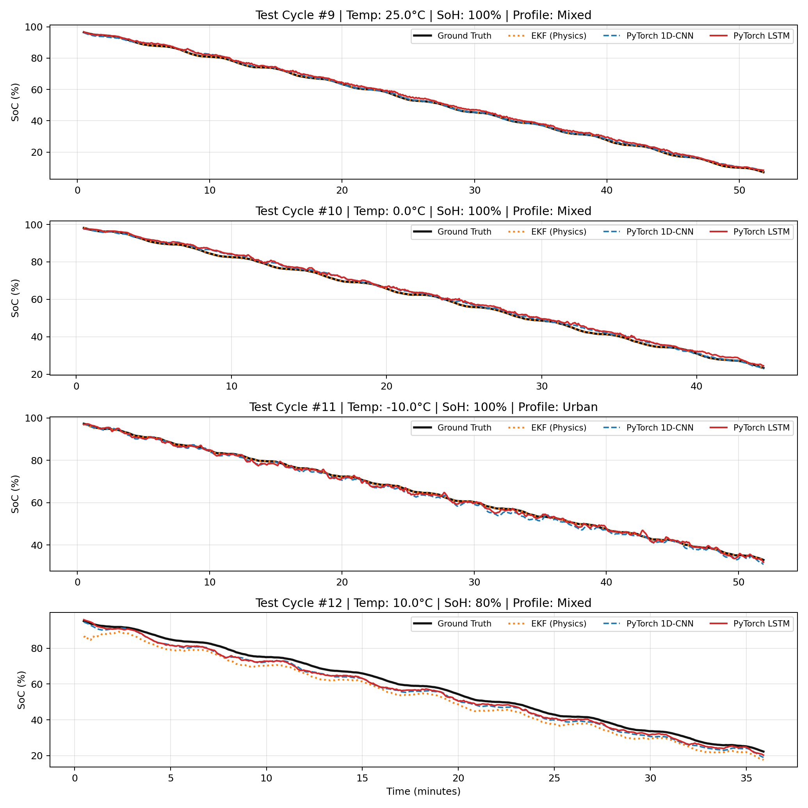
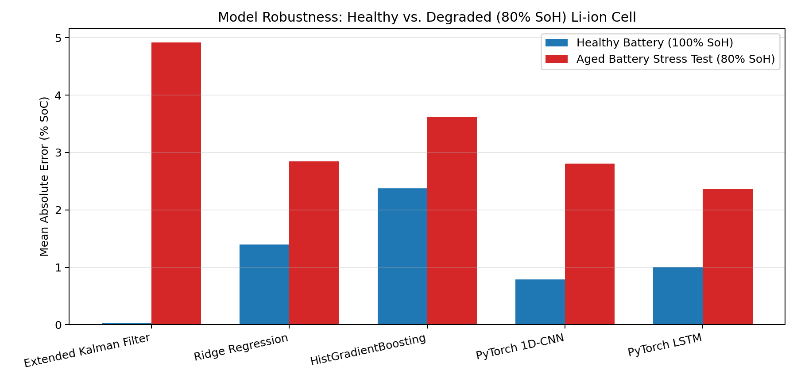

# EV Battery State-of-Charge (SoC) Estimation: Physics (EKF) vs. Deep Learning & ONNX Edge Deployment

An end-to-end Battery Management System (BMS) telemetry benchmark comparing classical physics-based estimation (**Extended Kalman Filter**) against tabular ML and sequential deep learning (**PyTorch LSTM** & **1D-CNN**) across temperatures (**-10°C to +25°C**) and battery aging (**80% SoH**), with **Monte Carlo Dropout** uncertainty quantification and **ONNX Runtime** CPU latency profiling.

---

## Engineering Motivation

Under dynamic acceleration and regenerative braking, Li-ion terminal voltage ($V_{\text{term}}$) diverges from Open-Circuit Voltage ($\text{OCV}$) due to temperature- and SoC-dependent internal resistance ($R_0$) and RC polarization ($V_{RC}$):

$$V_{\text{term}}(t) = \text{OCV}(\text{SoC}(t)) - I(t) \cdot R_0(T, \text{SoC}) - V_{RC}(t)$$

While a nominal **Extended Kalman Filter (EKF)** excels on a brand-new cell, real-world EV packs experience capacity fade and impedance growth over time. This benchmark explicitly evaluates how each method degrades under an unseen **80% State-of-Health (SoH)** stress test (+35% internal resistance, -20% capacity, and sensor bias).

---

## Architecture & Pipeline

- `src/generate_battery_data.py` — 1st-order Thevenin Equivalent Circuit Model (ECM) simulating 12 urban, highway, and mixed drive cycles (34,516 telemetry rows) from `-10°C` to `25°C`, including healthy (100% SoH), moderately aged (90% SoH), and unseen degraded (80% SoH) cells.
- `src/ekf.py` — Analytical Extended Kalman Filter baseline using nominal cell parameters and realistic initial SoC offset (`90%`).
- `src/models.py` — Two PyTorch sequential architectures:
  - **SoCLSTM:** 2-layer LSTM with a Dropout regression head supporting **Monte Carlo Dropout** (95% confidence bands).
  - **SoC1DCNN:** Lightweight Temporal 1D-CNN designed for low-latency embedded BMS inference.
- `src/train_and_evaluate.py` — Physics-informed rolling feature engineering (`15s`, `60s`, `180s`), GPU training (Huber Loss + Cosine Annealing), 5-model evaluation, ONNX export, and CPU latency benchmarking.

---

## Benchmark Results (Unseen Test Cycles)

| Model | All Cycles MAE (%) | Healthy 100% SoH MAE (%) | Aged 80% SoH MAE (%) | RMSE (%) | $R^2$ |
| :--- | :---: | :---: | :---: | :---: | :---: |
| **Extended Kalman Filter (Physics)** | **0.985** | **0.033** | 4.921 | 2.211 | 0.99052 |
| **Ridge Regression (Linear)** | 1.683 | 1.401 | 2.846 | 2.037 | 0.99195 |
| **HistGradientBoosting (Tabular)** | 2.617 | 2.374 | 3.623 | 3.601 | 0.97485 |
| **PyTorch 1D-CNN (Edge DL)** | 1.181 | 0.788 | 2.807 | 1.568 | 0.99523 |
| **PyTorch LSTM (Sequential DL)** | 1.270 | 1.007 | **2.358** | **1.548** | **0.99535** |

### Key Takeaways
1. **Aging Robustness:** When cell parameters drift at 80% SoH, nominal EKF error jumps from `0.033%` to `4.921%` MAE. The **PyTorch LSTM** cuts aged-cell error by **>52%** (`2.358%` MAE) and delivers the lowest overall RMSE (`1.548%`).
2. **Real-Time Edge Performance (ONNX Runtime CPU, Batch Size = 1):**

| Exported ONNX Model | Latency (ms/sample) | Throughput (Hz) | Model Size (KB) |
| :--- | :---: | :---: | :---: |
| `models/soc_lstm.onnx` | 0.162 ms | 6,154 Hz | 221.9 KB |
| `models/soc_1dcnn.onnx` | **0.069 ms** | **14,536 Hz** | **110.7 KB** |

Both models exceed standard automotive BMS sampling rates (10–100 Hz) by orders of magnitude on CPU, with **1D-CNN** running **2.3× faster** at half the memory footprint.

---

## Visual Results

### 1. SoC Tracking Across Temperatures (-10°C to 25°C) & 80% SoH Aging


### 2. Model Robustness: Healthy (100% SoH) vs. Aged (80% SoH) Cell


### 3. Safety-Aware Uncertainty Quantification (MC Dropout 95% Confidence Band)


---

## Quickstart

```bash
git clone [https://github.com/printulfericit1/ev-battery-soc-estimation.git](https://github.com/printulfericit1/ev-battery-soc-estimation.git)
cd ev-battery-soc-estimation
pip install -r requirements.txt

python src/generate_battery_data.py
python src/train_and_evaluate.py